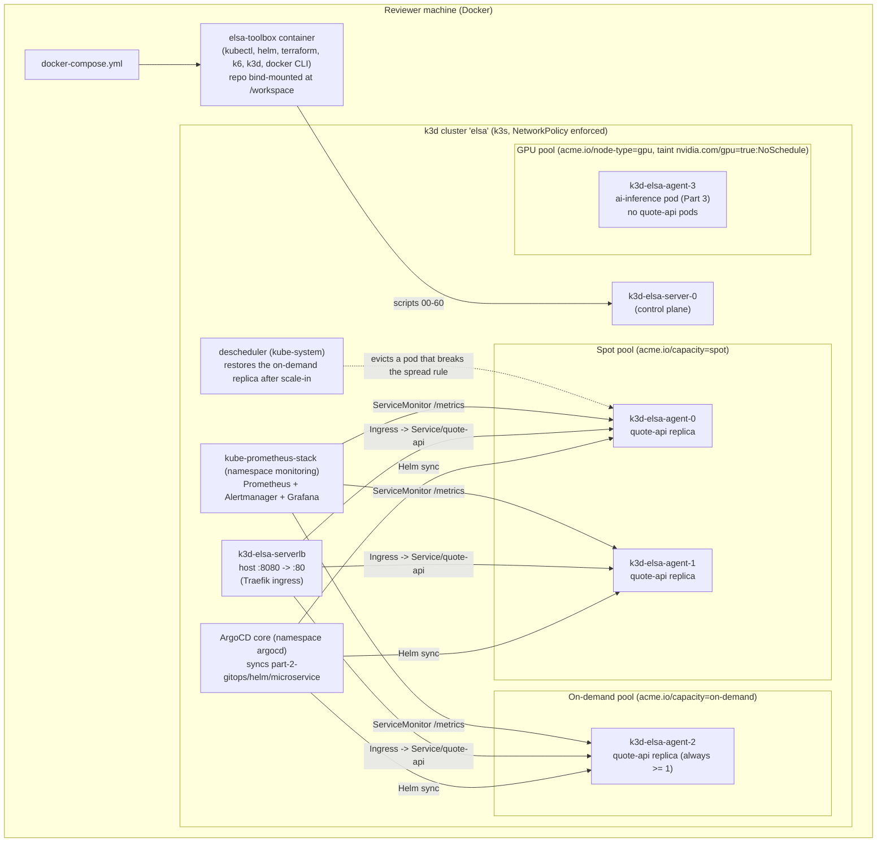
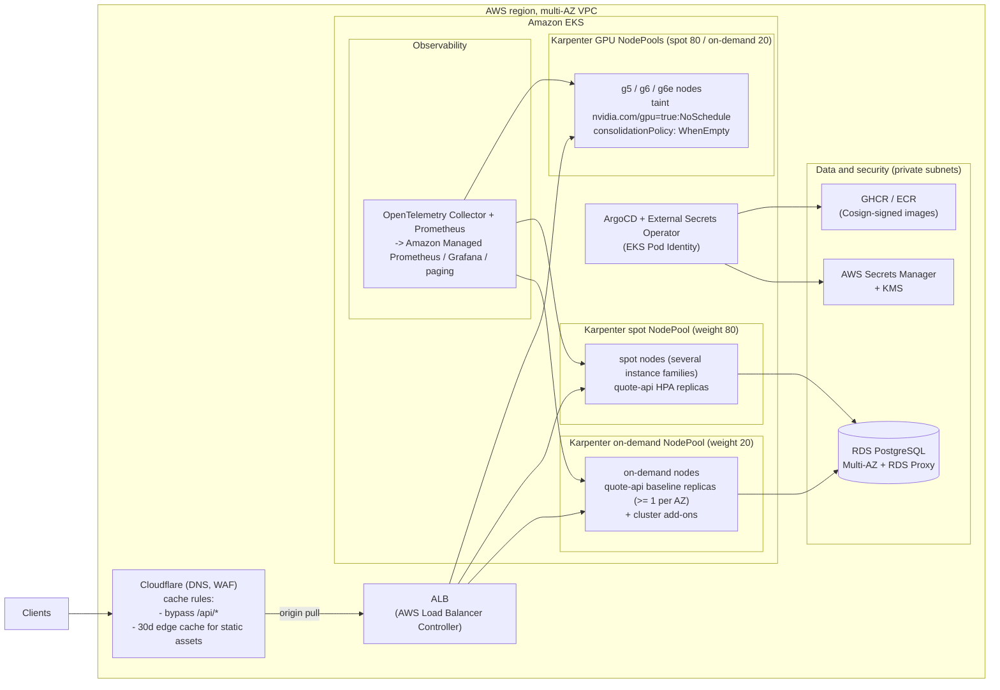

# DevOps Take-Home Assignment

A local, self-contained platform: a k3d cluster with spot / on-demand / GPU node pools, a small Node.js service deployed through ArgoCD, a GitHub Actions pipeline with hard-failing gates, Karpenter and Cloudflare IaC (validate-only), and a k6 + Prometheus/Grafana load test with HPA scale-out.

Deliverables required by the assignment, all at the repo root:
[TROUBLESHOOTING.md](TROUBLESHOOTING.md) (Part 3) ·
[MIGRATION-NOTES.md](MIGRATION-NOTES.md) (Part 4) ·
[LOADTEST.md](LOADTEST.md) (Part 6) ·
[OPS-ANSWERS.md](OPS-ANSWERS.md) (Part 7) ·
[AI-USAGE.md](AI-USAGE.md)

---

## 1. Quick start

```bash
git clone <your-repo> && cd <your-repo>
docker compose up -d
./scripts/run-all.sh        # or run scripts/NN-*.sh one by one
```

Then, from your machine:

```bash
curl http://localhost:8080/api/quote
```

- **Time:** a first run on an empty Docker cache took about 13 minutes on a 4 vCPU / 8 GB Docker Desktop; most of it is image downloads. Later runs are faster.
- **No local tools needed:** every script re-runs itself inside the `elsa-toolbox` container, which has kubectl, helm, terraform, k3d and k6.
- **Your own kubeconfig is never used.** The cluster's kubeconfig lives in the toolbox. To run `kubectl` by hand, open a shell there: `docker exec -it elsa-toolbox bash`.

---

## 2. Architecture

### 2a. Local harness (compose → k3d → ArgoCD → quote-api)



### 2b. Bonus: the same service in production on AWS



---

## 3. Repository layout

```text
.
├── README.md                     # this file
├── AI-USAGE.md                   # AI tools, prompts, mistakes caught
├── TROUBLESHOOTING.md            # Part 3 write-up
├── MIGRATION-NOTES.md            # Part 4 write-up
├── LOADTEST.md                   # Part 6 write-up
├── OPS-ANSWERS.md                # Part 7 answers
├── ASSIGNMENT - DevOps.md        # the assignment itself
├── docker-compose.yml            # toolbox container (creates the k3d cluster on start)
├── toolbox/Dockerfile            # pinned kubectl, helm, terraform, k3d, k6 (amd64 + arm64)
├── scripts/                      # numbered scripts + lib.sh (shared helpers)
├── troubleshoot/                 # provided files + our fixed-app.yaml (Part 3)
├── ci/legacy.gitlab-ci.yml       # provided legacy pipeline (Part 4 input)
├── .github/workflows/ci.yml      # Part 4 pipeline
├── .semgrep.yml                  # Part 4 custom Semgrep rules
├── part-1-service/               # Node.js service, tests, Dockerfile
├── part-2-gitops/
│   ├── helm/microservice/        # Helm chart + values-quote-api.yaml overlay
│   ├── argocd/                   # Application + least-privilege AppProject
│   └── descheduler/values.yaml   # keeps an on-demand replica after HPA scale-in
├── part-3-troubleshoot/          # copy of fixed-app.yaml + TROUBLESHOOTING.md
├── part-4-cicd/                  # copy of the workflow, Semgrep rules, MIGRATION-NOTES.md
├── part-5-iac/                   # Karpenter YAML + Cloudflare Terraform
├── part-6-loadtest/              # k6 script, monitoring manifests, dashboard JSON + screenshot
├── part-7-ops/                   # copy of OPS-ANSWERS.md
├── tools/headlamp/               # optional cluster UI (scripts/70-headlamp.sh)
└── prompts/                      # prompts used to build each part
```

The `part-3-troubleshoot/`, `part-4-cicd/` and `part-7-ops/` folders hold copies of the root deliverables so each part can be read on its own. The root files are the ones the scripts and CI use; keep the copies identical.

---

## 4. How each part is solved

**Part 1, service** ([part-1-service/](part-1-service/README.md)). Express app with `/healthz`, `/readyz` (returns 503 after SIGTERM so traffic drains before shutdown), `/metrics` (prom-client, custom request counter and latency histogram) and `/api/quote` (about 100 ms of real CPU work, done in 10 ms slices so health probes are answered under load). Two-stage Dockerfile: `node:24-trixie-slim` installs production dependencies, `gcr.io/distroless/nodejs24-debian13:nonroot` runs them as UID 65532 with no shell. Image tag: `sha-<12-char git sha>`, the same in local builds and CI.

**Part 2, GitOps and placement** ([part-2-gitops/](part-2-gitops/README.md)). ArgoCD (core install) syncs our Helm chart from the repo, with the built image passed as Helm parameters. The chart has probes, requests/limits, non-root + read-only root filesystem, Service + Ingress, HPA (min 3, max 10, 60% CPU) and a PDB (min 2 available). Placement:
- required node affinity to spot or on-demand, so nothing lands on the GPU node,
- preferred affinity spot 60 / on-demand 40,
- hard spread across the two pools with `maxSkew: 2`, so a 3/0 split is impossible (at least one on-demand replica) while spot keeps the majority; drained nodes are not counted (`nodeTaintsPolicy: Honor`),
- soft spread across nodes, so rescheduling never blocks,
- a descheduler, because spread rules are not re-checked on HPA scale-in (testing showed all 3 pods left on spot; it restores an on-demand replica in about 30 s).

`scripts/25-reclaim-drill.sh` drains a spot node while curling the service and fails on any dropped request (6/6 OK in the last run).

**Part 3, troubleshooting** ([TROUBLESHOOTING.md](TROUBLESHOOTING.md)). Eight issues fixed in `troubleshoot/fixed-app.yaml`: image tag, memory request, ConfigMap name, probe ports, Service selector and targetPort, GPU nodeSelector key, missing GPU toleration, and the NetworkPolicy. `default-deny` is kept; two narrow allow policies add web ingress from the smoke client and the smoke client's egress to DNS and to web. `verify.sh` prints PASS.

**Part 4, CI/CD** ([MIGRATION-NOTES.md](MIGRATION-NOTES.md)). Three jobs: unit tests (Node 24, `npm ci`, no soft-fail), Semgrep with `--error` (registry rules + `.semgrep.yml`), and build → Trivy (HIGH/CRITICAL fails) → push the same image → Cosign keyless signature on the digest. Runs on pull requests too; push and sign only on main. Actions are pinned to commit SHAs and each job has only the permissions it needs. Both gates were run locally with the CI tools: Semgrep 0 findings, Trivy 0 HIGH/CRITICAL.

**Part 5, IaC** ([part-5-iac/](part-5-iac/README.md)). Karpenter v1: one EC2NodeClass (pinned Bottlerocket) and two GPU NodePools (spot weight 80, on-demand weight 20), GPU taint, `WhenEmpty` consolidation, limits. Cloudflare provider v5: proxied DNS record, cache rules (bypass `/api/*`, long cache for static files), an `import` block, no hard-coded account values. `scripts/50-validate-tf.sh` passes.

**Part 6, load test** ([LOADTEST.md](LOADTEST.md)). kube-prometheus-stack, ServiceMonitor, two alerts (P95 > 450 ms for 2 min, 5xx > 1%), a 4-panel dashboard ([JSON](part-6-loadtest/monitoring/grafana-dashboard.json), [screenshot during a run](part-6-loadtest/monitoring/grafana-dashboard-under-load.png)). k6 ramps to 20 VUs: HPA 3 → 10 in about 75 s, 0% errors, P95 275–316 ms, 6 spot / 4 on-demand at peak.

**Part 7, ops answers** ([OPS-ANSWERS.md](OPS-ANSWERS.md)). EKS 1.33 → 1.35 upgrade order and risks, spot alert storms, Cloudflare HTML caching diagnosis, and secrets on EKS (ESO recommended). About 700 words, within the 1.5-page limit.

---

## 5. Script reference

Run from the repo root on your machine; scripts 00-80 hand themselves to the toolbox automatically.

| Script | When | What it does |
|---|---|---|
| `00-bootstrap-cluster.sh` | Runs on `docker compose up -d` | Creates (or starts) the k3d cluster with 1 server + 4 agents, writes the kubeconfig, waits for nodes, runs `troubleshoot/prepare.sh` |
| `10-build-service.sh` | Part 1 | Builds `ghcr.io/<owner>/<repo>/quote-api:sha-<git sha>` (name derived from the git remote, same as CI), pushes it if `GHCR_USER`/`GHCR_TOKEN` are set, imports it into k3d |
| `20-deploy.sh` | Part 2 | Installs ArgoCD + AppProject, syncs the chart (from GitHub on a clean clone, from an in-cluster git mirror if the local chart differs), passes the image as Helm parameters, installs the descheduler, shows placement, curls `/api/quote` |
| `25-reclaim-drill.sh` | Part 2 | Drains a spot node while curling the service, shows rescheduling, uncordons, fails on any dropped request |
| `30-troubleshoot.sh` | Part 3 | Applies `troubleshoot/fixed-app.yaml` and runs `troubleshoot/verify.sh` (prints PASS) |
| `40-verify-ci.sh` | Part 4 | Checks the workflow and notes exist, no hardcoded AWS keys, no soft-failing gates, every action pinned to a SHA |
| `50-validate-tf.sh` | Part 5 | Checks the Karpenter API versions and label keys; `terraform fmt -check`, `init -backend=false`, `validate` |
| `60-loadtest.sh` | Part 6 | Installs kube-prometheus-stack, applies monitoring resources and dashboard, runs k6, prints HPA changes and placement |
| `70-headlamp.sh` | Optional | Headlamp UI at `http://headlamp.localhost:8080` with a 24 h read-only token |
| `80-network-test.sh` | Optional | Tests the API from inside the cluster at every network layer, including NetworkPolicy enforcement |
| `90-stop.sh` | Optional, host only | Stops the cluster and toolbox, keeps all state; resume with `docker compose up -d` |
| `99-cleanup.sh` | Optional, host only | Deletes everything this project created; `--dry-run`, `--yes`, `--images` |
| `run-all.sh` | Golden Rule | Runs 00-60 in order, stops at the first failure, prints a time per step |
| `lib.sh` | Sourced | Shared helpers: hand-off to the toolbox, logging, `run_logged`, `show_placement`, image name/tag |

Noisy output (helm, docker build, terraform init) goes to `/tmp/elsa-logs/` inside the toolbox and is printed only when a command fails.

---

## 6. Design decisions and what was cut

- **Distroless Node 24 image.** No shell or package manager and a non-root user, so less to attack and patch. Node 24 because the Node 20 / Debian 12 images failed the Trivy gate (unpatched OpenSSL) and Node 20 is end of life.
- **Existing `microservice` chart instead of a new one.** It is a chart I wrote for earlier work and reused, with a small overlay holding only quote-api's values. It also supports other runtimes (Java ConfigMap properties, OpenShift Routes), which this assignment does not use.
- **Hard spread with `maxSkew: 2` plus a descheduler.** A soft rule only prefers on-demand, and `maxSkew: 1` would force 50/50 and cost more. Details in [part-2-gitops/README.md](part-2-gitops/README.md).
- **ArgoCD core install.** Nothing here needs the UI or SSO. Core install has no `argocd-server`, which normally creates the `default` project, so the repo ships a least-privilege AppProject.
- **Image tag as an ArgoCD Helm parameter.** A commit cannot contain its own SHA, so writing the tag into Git would always make the local chart differ from GitHub. Passing it as a parameter keeps Git unchanged and lets ArgoCD sync straight from the repo.
- **Pinned versions everywhere** (tools, charts, actions, provider lock file), so the reviewer runs what was tested.
- **Cut:**
  - TLS / cert-manager locally: the reviewer uses `http://localhost:8080`, and self-signed certificates add warnings without adding signal.
  - Persistent storage for Prometheus: two days of in-cluster retention is enough for a local test and avoids volume permission issues across Docker Desktop platforms.
  - OpenTelemetry tracing (bonus): metrics already answer the Part 6 questions; tracing would add a collector and SDK for no requirement.
  - Optional helpers (Headlamp, network test, stop/cleanup) are not in `run-all.sh`, so the reviewer's run stays as short as possible.

---

## 7. Notes on the handoff (provided files and surprises)

The assignment asks to treat broken or inconsistent inputs like an incident. What was found:

- `troubleshoot/broken-app.yaml` is intentionally broken in eight ways; see [TROUBLESHOOTING.md](TROUBLESHOOTING.md).
- `ci/legacy.gitlab-ci.yml` contains the practices Part 4 asks to remove; see [MIGRATION-NOTES.md](MIGRATION-NOTES.md).
- Surprises found while running everything from a clean machine, and the fix for each:
  - ArgoCD core install creates no `default` AppProject, so the Application never synced → ship `part-2-gitops/argocd/project.yaml`.
  - ArgoCD's go-git client cannot read a plain static (nginx) git server → the local mirror uses `git daemon`.
  - Debian 12 distroless images no longer receive fixes; Trivy found 1 CRITICAL and 6 HIGH → Debian 13 / Node 24.
  - Pulling the ArgoCD image took about 3 minutes per node on a cold machine → 10-minute timeouts for steps that pull images.
  - Grafana 13 runs database migrations on first start, which took minutes at 250m CPU → 1 CPU limit and a pinned chart version.

---

## 8. Troubleshooting on the reviewer's machine

1. **Port 8080 is taken** (`port is already allocated`): pick another port for both commands:
   ```bash
   INGRESS_PORT=8888 docker compose up -d
   INGRESS_PORT=8888 ./scripts/run-all.sh
   ```
2. **Too little Docker memory or CPU** (pods `Pending` or `OOMKilled` in Part 6): everything was tested with 4 vCPU and 8 GB in Docker Desktop; give Docker at least that.
3. **Apple Silicon:** the toolbox downloads arm64 binaries automatically and the base images are multi-arch, so no emulation is needed.
4. **`kubectl` on your machine shows another cluster:** expected; the scripts use the toolbox's kubeconfig. Use `docker exec -it elsa-toolbox bash` to work with this cluster.
5. **A step times out on the first run:** usually a slow image download. Re-run the same script; every script is safe to re-run.

---

## 9. Working method

- **Verify by running, not by reading.** Every claim in these docs comes from a run: unit tests, `helm lint`/`template`, `terraform validate`, the CI gates run locally, a clean-machine Golden Rule run, the reclaim drill, and three load tests. Several real bugs were found this way (see section 7 and [AI-USAGE.md](AI-USAGE.md)).
- **Safe to re-run.** Scripts use `kubectl apply`, `helm upgrade --install` and existence checks, so running them twice changes nothing.
- **One source of truth per artifact.** One dashboard JSON (the ConfigMap is generated from it), one image name and tag function shared by the build and deploy scripts, and only the overlay values that differ from the chart defaults.
